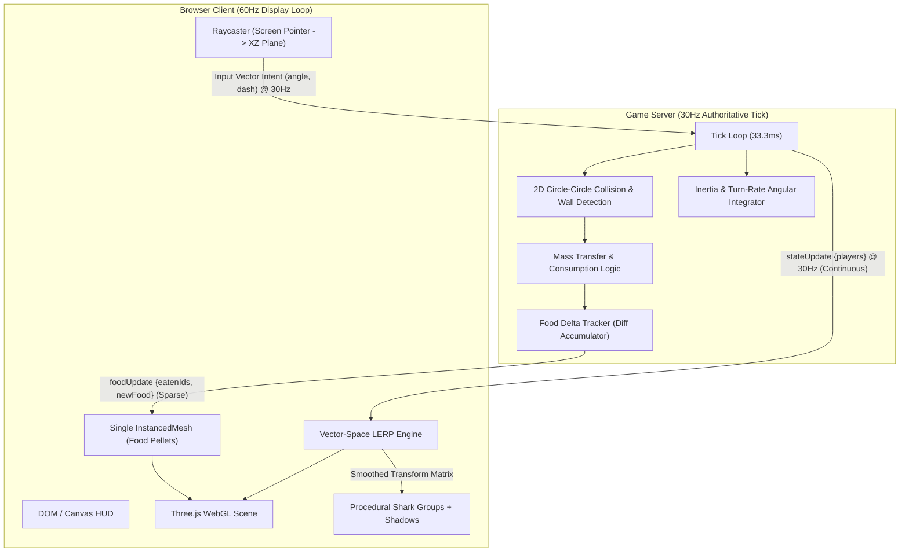

# HappyShark.io

[](https://onlineshark-io.vercel.app)
[](https://threejs.org/)
[](https://socket.io/)
[](https://nodejs.org/)
[](https://vitejs.dev/)
[](https://render.com/)

> **[Play HappyShark.io Live Demo](https://onlineshark-io.vercel.app)** — High-frequency real-time multiplayer arena running in WebGL.

---

## 1. Overview

**HappyShark.io** is a competitive, high-throughput 2.5D multiplayer arena game designed from first principles around an **Authoritative Server Architecture**. Players command procedurally synthesized 3D sharks competing for oceanic biomass within a continuous Cartesian simulation.

Traditional browser-based `.io` games frequently stumble into common architectural pitfalls: trust-in-client vulnerabilities, network saturating serialization protocols, and severe draw-call thrashing when scaling entity counts. HappyShark.io sidesteps these bottlenecks by decoupling a deterministic, **strict 2D server-side physics simulation** from an **interpolated 3D WebGL projection plane**, maximizing server compute density while delivering smooth 60 FPS client fidelity without external asset load overhead.

---

## 2. System Architecture

The runtime utilizes an asymmetrical client-server topography separated by continuous network packet boundaries:



### Decoupled Execution Characteristics

| Layer | Domain | Rate | Key Responsibilities |
| :--- | :--- | :--- | :--- |
| **Server** (`/server`) | Node.js + Express + Socket.IO | **30 Hz** (33.3ms tick) | Authoritative game state, kinematic vector integration, circle-circle collision sweeps, mass transfer, lethal boundaries, delta broadcast formatting. |
| **Client** (`/client`) | Three.js + Vite | **60 Hz** (V-Sync) | Mouse-to-water-plane raycasting, vector-space linear interpolation (LERP), instanced buffer attribute updates, dynamic sinusoidal procedural animation. |

---

## 3. Engineering Highlights & Deep Dive

### A. Defeating Multiplayer Cheating via Strict Server Authority
* **The Problem:** Peer-to-peer (P2P) and client-authoritative network topologies expose state variables (player position, speed, collision flags, mass) directly to memory modification and proxy tampering. In fast-paced IO games, malicious clients can arbitrarily scale hitboxes, falsify coordinates, or inject impossible velocities.
* **Architectural Decision:** Absolute Server Authority. The browser runtime retains zero jurisdiction over state mutation. Clients transmit purely **input intention vectors** (`targetAngle: number`, `dash: boolean`) sampled at 30 Hz.
* **Implementation Details:**
  * The server integrates directional headings constrained by an immutable maximum turn rate:
    $$\Delta \theta = \text{clamp}(\text{angleDelta}(\theta, \theta_{\text{target}}), -\omega_{\max} \cdot \Delta t, \omega_{\max} \cdot \Delta t)$$
  * Velocity vectors are strictly computed server-side along the shark's actual physical orientation, completely neutralizing client-spoofed position injection.

### B. Bandwidth Optimization: Event-Driven Delta Compression (178× Reduction)
* **The Problem:** The arena maintains a baseline equilibrium of 500+ food pellets, swelling up to 1,200 during high-casualty skirmishes. Emitting the naive snapshot of all pellets at 30 Hz produced a network serialization payload exceeding:
  $$500 \text{ entities} \times 24 \text{ bytes (ID, X, Y, Color)} \times 30 \text{ Hz} \approx 360\text{ KB/s per client}$$
  With 20 concurrent connections, outbound traffic saturated upstream bandwidth (>7.2 MB/s), triggering socket backpressure and catastrophic packet queuing.
* **The Solution:** Decouple continuous state (player transforms) from discrete events (food consumption and emergence). We replaced naive full-array serialization with an **event-driven differential delta pipeline**:
  1. Pellets maintain immutable indices.
  2. The server records consumed IDs into a `tickEatenFood` queue and newborn pellets into `tickNewFood`.
  3. The network layer broadcasts `foodUpdate` packets **only when diff sets are non-empty**, falling back to 0 bytes during steady-state cruising.
* **The Result:** Steady-state per-tick food payload dropped from ~12 KB to ~70 bytes—a **178× bandwidth reduction**, enabling smooth execution even on bandwidth-constrained mobile networks.

### C. Extreme Rendering Performance: Draw Call Reduction via Instancing
* **The Problem:** Treating each food pellet as an autonomous `THREE.Mesh` generated over 500 discrete WebGL draw calls (`glDrawElements`). On mobile GPUs and integrated silicon, CPU-to-GPU command buffer driver overhead choked the render thread down to 18–25 FPS.
* **The Solution:** Migrated food pellet geometry into a single `THREE.InstancedMesh` with pre-allocated buffer capacity (`FOOD_INSTANCE_CAPACITY = 2000`). Position, scale, and color arrays are packed directly into dynamic hardware instance buffers:
  ```javascript
  const foodInstancedMesh = new THREE.InstancedMesh(
    foodGeometry,
    foodMaterial,
    FOOD_INSTANCE_CAPACITY
  );
  foodInstancedMesh.instanceMatrix.setUsage(THREE.DynamicDrawUsage);
  foodInstancedMesh.instanceColor.setUsage(THREE.DynamicDrawUsage);
  ```
* **The `frustumCulled = false` Bug:** Three.js evaluates bounding volume culling based on the initial default bounding sphere of the root geometry. Because instances dynamically spread across a $3000 \times 3000$ world space, the localized bounding sphere frequently fell outside the camera frustum when looking away from the world origin, causing the entire instanced collection to vanish. Explicitly disabling frustum culling (`foodInstancedMesh.frustumCulled = false`) eliminated the false-positive culled batches while preserving single-draw-call performance at 60 FPS.

### D. 2.5D Isometric Projection & Ground-Plane Raycasting
* **The Problem:** Simulating true 3D spatial collisions (capsule sweeps, bounding box hierarchies) on a high-density Node.js event loop is computationally prohibitive. Conversely, calculating mouse angles directly in 2D screen space causes parallax distortion when projected onto a tilted 3D perspective camera (a mouse pointer at screen top-left points to an unnatural spatial trajectory).
* **The Solution:** 
  1. The server operates strictly in a 2D Euclidean plane $(X, Y) \in [0, W] \times [0, H]$.
  2. The client projects server $(x, y)$ coordinates onto the 3D ground plane as $(x, 0, z = y)$.
  3. Screen-to-world steering is resolved using unprojected raycasts against an infinite horizontal plane:
     ```javascript
     const groundPlane = new THREE.Plane(new THREE.Vector3(0, 1, 0), 0);
     raycaster.setFromCamera(pointer, camera);
     const hit = raycaster.ray.intersectPlane(groundPlane, groundHit);
     
     if (hit) {
       const dx = groundHit.x - me.x;
       const dz = groundHit.z - me.y;
       targetAngle = Math.atan2(dz, dx);
     }
     ```
  This eliminates perspective-induced foreshortening along the vertical viewport axis, ensuring that the shark points with millimeter precision toward the reticle.

### E. Zero-Asset Procedural 3D Generation & Sinusoidal Dynamics
* **The Problem:** External 3D model formats (`.gltf`, `.obj`, `.fbx`) incur DNS latency, asset parser blocking, texture decoding overhead, and rigid UV-mapping limitations.
* **The Solution:** Sharks are procedurally synthesized purely in code using primitive geometries:
  * Torso: Scaled `THREE.SphereGeometry(1, 22, 16)` compressed into a hydrodynamic teardrop.
  * Snout & Fins: Transformed `THREE.ConeGeometry` instances aligned across anatomical pivots.
  * Shadows: Projected `THREE.CircleGeometry` decals positioned at constant arena offset to ground depth perception without expensive real-time shadow maps.
* **Locomotion Kinematics:** Tail and caudal fin oscillation frequencies modulate dynamically as a function of speed and boost state:
  $$\theta_{\text{tail}}(t) = \sin(t \cdot \omega_{\text{wag}} \cdot k_{\text{dash}}) \cdot \theta_{\max}$$
  Dynamic material instances allow instant palette shifts based on network-assigned player colors without extra shader compilations.

---

## 4. Gameplay Mechanics: The "Inertia Meta"

Unlike typical agar-like clones where giants dominate the map without counter-play, HappyShark.io implements an **inertia-governed geometric meta**:

```
+-------------------------------------------------------------------------+
| Small Shark: High Agility (Tight Turn Radius) | Top Speed = 250 px/s    |
| Turning Circle: 45 units  ----------------->  | Out-maneuvers Giants   |
+-------------------------------------------------------------------------+
| Giant Shark: High Mass (Wide Turn Radius)     | Top Speed = 250 px/s    |
| Turning Circle: 250 units ----------------->  | Slow Angular Response   |
+-------------------------------------------------------------------------+
```

### Governing Equations & Dynamics
* **Universal Top Speed:** All sharks share the identical base cruising velocity ($v = 250 \text{ px/s}$). A giant cannot simply chase down a novice in a straight line.
* **Angular Turn-Rate Penalty:** Agility decays hyperbolically as mass increases:
  $$\omega(r) = \max\left(\omega_{\min}, \frac{\omega_{\text{base}}}{1 + \frac{r}{D_{\text{turn}}}}\right)$$
  Where $\omega_{\text{base}} = 6.0 \text{ rad/s}$, $\omega_{\min} = 1.0 \text{ rad/s}$, and $D_{\text{turn}} = 50$. A fresh shark executes a pivot circle of radius $45$, whereas an apex predator requires a wide arc of $250$, allowing agile small sharks to evade predators by diving inside their turning circle.
* **Mass Conservation & Dash Penalty:** Dashing provides a $1.5\times$ velocity multiplier for $1.0\text{s}$, but demands a direct burn of 5 score units. Drained mass is dropped behind as food, turning speed bursts into high-stakes risk calculations.
* **Lethal World Boundaries:** Arena boundaries are deadly hazards rather than soft barriers, preventing perimeter pinning strategies.

---

## 5. Local Setup & Verification

### Prerequisites
* **Node.js** $\ge$ 18.0.0
* **npm** $\ge$ 9.0.0

### Repository Structure
```text
├── client/          # Vite + Three.js browser application
│   ├── src/
│   │   └── main.js  # Scene graph, raycasting, LERP, InstancedMesh management
│   ├── index.html   # UI Overlay and WebGL canvas mounting point
│   └── package.json
├── server/          # Node.js + Express + Socket.IO authoritative engine
│   ├── server.js    # 30Hz simulation loop, collision grid, delta serializer
│   └── package.json
└── README.md
```

### Step 1: Initialize the Server
```bash
cd server
npm install
npm run dev
```
* The server boots on `http://localhost:3000` with tick rate fixed at 30 Hz.

### Step 2: Initialize the Client
In a separate terminal session:
```bash
cd client
npm install
npm run dev
```
* The Vite dev server will expose the application on `http://localhost:5173`.

### Environment Configuration
| Variable | Context | Default | Description |
| :--- | :--- | :--- | :--- |
| `PORT` | Server | `3000` | HTTP & WebSocket listening port. |
| `CLIENT_ORIGIN` | Server | `*` | Allowed CORS origin for production environments. |
| `VITE_SERVER_URL` | Client | `http://localhost:3000` | Target backend URL for Socket.IO connection. |

For production client builds targeting external backends:
```bash
# In /client
VITE_SERVER_URL="https://your-backend-service.onrender.com" npm run build
```

---

## 6. Known Limitations & Engineering Trade-offs

Intellectual honesty is central to sound systems design. The following trade-offs were consciously made in the current release:

1. **Uniform Pellet Generation vs. Spatial Clustering:**
   * *Trade-off:* Pellets spawn uniformly across the arena margin-safe bounds to avoid localized resource starvation.
   * *Limitation:* The absence of dynamic spatial density heatmaps (e.g., higher food density in map epicenters or near recent kill zones) leads to relatively even player dispersion rather than funneling players into intentional territorial hotspots.

2. **Authoritative Movement LERP vs. Client-Side Prediction with Rollback:**
   * *Trade-off:* We prioritized absolute anti-cheat integrity, zero desynchronization bugs, and a lightweight client runtime by adopting an authoritative state broadcast paired with client-side linear interpolation:
     $$\mathbf{x}_{\text{render}} = \text{lerp}(\mathbf{x}_{\text{current}}, \mathbf{x}_{\text{target}}, 0.3)$$
   * *Limitation:* On connections with round-trip times (RTT) exceeding 120ms, players experience slight rotational and translational input lag between a mouse flick and the visual response, as the client awaits authoritative server state before smoothing. Implementing client-side prediction with client rollback reconciliation is planned for future iterations.

---

## 7. License

Distributed under the **ISC License**. Feel free to fork, adapt, and build upon this architecture.
