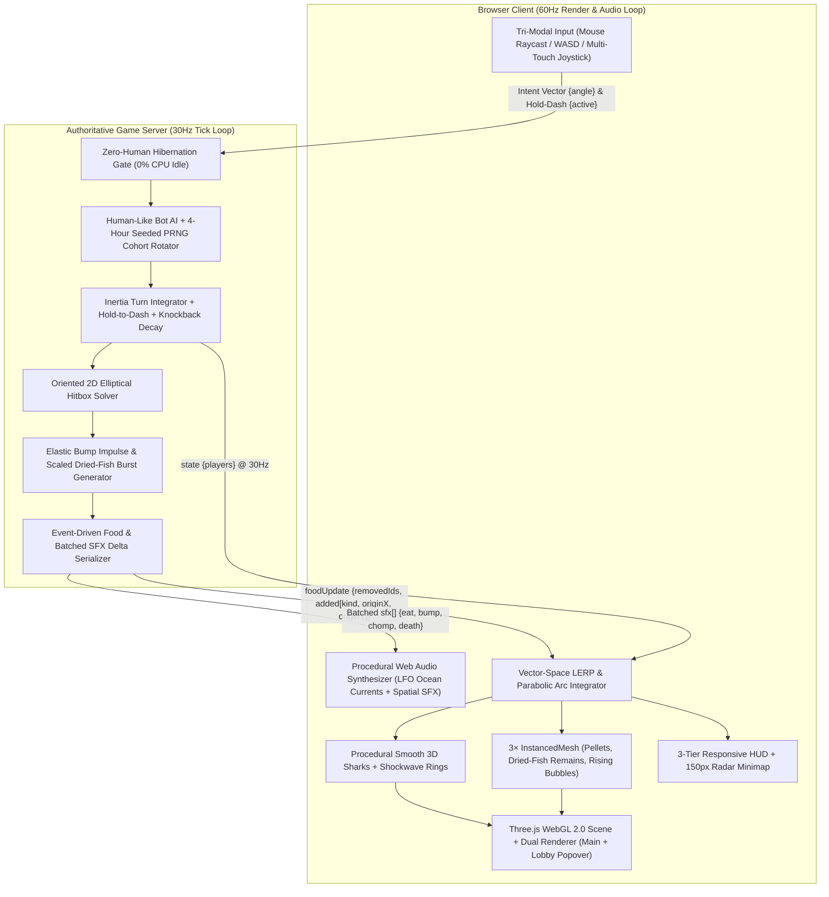

# 🦈 HappyShark.io

[](https://onlineshark-io.vercel.app)
[](https://threejs.org/)
[](https://developer.mozilla.org/en-US/docs/Web/API/Web_Audio_API)
[](https://socket.io/)
[](https://nodejs.org/)
[](https://vitejs.dev/)
[](https://render.com/)

> **[Play HappyShark.io Live Demo](https://onlineshark-io.vercel.app)** — High-frequency 2.5D real-time multiplayer arena running in WebGL with 100% procedural 3D assets and real-time Web Audio synthesis.

---

## 1. Overview

**HappyShark.io** is a competitive, high-throughput 2.5D multiplayer `.io` arena game engineered from first principles around an **Authoritative Server Architecture**. Players command procedurally synthesized 3D sharks across a $5000 \times 5000$ oceanic simulation, competing for biomass against human rivals and autonomous, human-like AI agents.

Traditional browser-based `.io` games frequently suffer from trust-in-client vulnerabilities, network-saturating state broadcasts, severe WebGL draw-call bottlenecks, and circular hitbox inaccuracies that mismatch elongated character models. HappyShark.io resolves these bottlenecks by pairing a **deterministic 30 Hz 2D server simulation** (featuring oriented elliptical hitboxes, elastic knockback impulses, and delta-compressed packets) with a **60 Hz interpolated Three.js WebGL presentation layer**, a **zero-asset procedural Web Audio synthesizer**, and a **universal multi-device input & HUD engine**.

---

## 2. System Architecture

The runtime utilizes an asymmetrical client-server topography separated by continuous and event-driven network packet boundaries:



### Decoupled Execution Characteristics

| Layer | Domain | Rate | Key Responsibilities |
| :--- | :--- | :--- | :--- |
| **Server** (`/server`) | Node.js + Express 5 + Socket.IO | **30 Hz** (33.3ms tick) | Authoritative state, oriented elliptical collision detection, elastic knockback impulses, strict mass conservation, autonomous AI ecosystem, zero-human hibernation, delta serialization. |
| **Client** (`/client`) | Three.js + Web Audio API + Vite | **60 Hz** (V-Sync) | Ground-plane raycasting, multi-touch virtual joystick, vector-space LERP, parabolic fish pop-out arcs, triple `InstancedMesh` pipelines, real-time procedural audio synthesis, 3-tier responsive HUD. |

---

## 3. Engineering Highlights & Deep Dive

### A. Authoritative Anti-Cheat & Oriented Elliptical Hitboxes

* **The Problem:**
  1. Client-authoritative or P2P topologies expose coordinates and hitboxes to memory tampering.
  2. Standard `.io` games approximate players as simple circles. However, a 3D shark has an elongated torso (length $\approx 2.1r$, flank width $\approx 1.04r$). Using circular collision causes frustrating "invisible flank deaths" where small sharks die upon touching the empty space beside a giant shark's body.
* **The Solution:**
  * **Strict Input-Only Protocol:** Clients transmit only directional intentions (`angle`) and boolean dash states (`active`).
  * **Oriented Elliptical Collision (`checkSharkCollision`):** To match the 3D anatomy without running expensive 3D mesh intersections on the server, the server transforms candidate coordinates into each shark's local heading frame via a 2D rotation matrix and evaluates an anisotropic ellipse equation:

    $$\begin{bmatrix} x_{\text{local}} \\ y_{\text{local}} \end{bmatrix} = \begin{bmatrix} \cos(-\theta_A) & -\sin(-\theta_A) \\ \sin(-\theta_A) & \cos(-\theta_A) \end{bmatrix} \begin{bmatrix} x_B - x_A \\ y_B - y_A \end{bmatrix}$$

    $$\frac{x_{\text{local}}^2}{(1.05\,r_A + 0.45\,r_B)^2} + \frac{y_{\text{local}}^2}{(0.52\,r_A + 0.45\,r_B)^2} \le 1$$

  This aligns physical hit detection tightly with the visible 3D body and tail fin while eliminating phantom side-hitbox deaths.

### B. Bandwidth Optimization: Event-Driven Delta Compression (178× Reduction)

* **The Problem:** The $5000 \times 5000$ arena maintains an equilibrium of 800+ food pellets, surging up to a hard cap of 1,500 during multi-shark skirmishes. Broadcasting the full food array at 30 Hz would consume $>500\text{ KB/s}$ per client, causing severe WebSocket backpressure.
* **The Solution:** We decoupled continuous player state from discrete food and audio events:
  1. Food items carry immutable IDs, types (`kind: 'pellet' | 'fish'`), and pop-out origin coordinates (`originX`, `originY`).
  2. Each tick accumulates only deltas (`addedFood` and `removedFoodIds`) alongside a deduplicated `sfxQueue` batch.
  3. `foodUpdate` and `sfx` packets are emitted **only when non-empty**, dropping steady-state food bandwidth from ~18 KB/tick to ~70 bytes (**178× reduction**).

### C. Triple `InstancedMesh` Pipeline & Frustum Culling Resolution

* **The Problem:** Rendering 1,500 food pellets, dozens of dried-fish remains, and 160 ambient rising bubbles as individual `THREE.Mesh` objects would exceed 1,700 WebGL draw calls per frame, crippling mobile and tablet GPUs.
* **The Solution:** The entire environmental ecosystem is packed into **three hardware-instanced buffers** (`THREE.InstancedMesh`), collapsing 1,700+ entities into **3 draw calls**:
  1. `foodInstancedMesh`: Glowing spherical plankton pellets (`capacity = 1500`).
  2. `fishInstancedMesh`: Custom-indexed 3D diamond-and-forked-tail dried fish (`魚乾`) meshes (`DoubleSide` amber material) dropped upon shark deaths and collisions.
  3. `bubbleInstancedMesh`: 160 translucent underwater bubbles continuously rising and wobbling across the water column.
* **Solving the `frustumCulled = false` Trap:** Three.js computes instanced bounding spheres from the base geometry at the origin. Across a $5000 \times 5000$ arena, panning the camera caused Three.js to falsely cull the entire food batch whenever the origin left the view frustum. Explicitly setting `.frustumCulled = false` on all instanced meshes guarantees zero pop-in at locked 60 FPS.

### D. Elastic Knockback Physics, Parabolic Fish Bursts & Pickup Grace Periods

* **The Problem:**
  1. When two similarly sized sharks collide, slow continuous mass drain feels static and lacks physical impact.
  2. When a large shark devours a smaller shark, instant 100% score absorption gives nearby scavengers zero opportunity to contest the kill.
* **The Solution:**
  * **Elastic Impulse & Exponential Decay:** Colliding sharks of comparable size trigger `elasticBump` (throttled per pair to 280ms), applying opposing knockback velocity vectors ($\|\mathbf{v}_{\text{knock}}\| = 520\text{ units/s}$) integrated alongside exponential drag ($\mathbf{v}_{t+\Delta t} = \mathbf{v}_t \cdot e^{-7.5\Delta t}$), accompanied by an expanding 3D shockwave ring.
  * **Strict Mass-Conserving Dried-Fish Burst:** Both elastic bumps (6% mass loss) and lethal events (PvP kills & wall crashes) convert lost biomass into golden 3D dried-fish (`kind: 'fish'`) scattered across a radius scaled by the victim's size ($r_{\text{inner}} = 0.65r + 28$, $r_{\text{outer}} = \min(360, 2.75r + 105)$), with exact remainder accounting so zero free mass is ever fabricated.
  * **Parabolic Pop-Out Arc & 320ms Grace Period:** Newly spawned fish carry `(originX, originY)` and a server-side `pickupReadyAt = now + 320ms` lock. For the first 330ms, the client interpolates each fish outward along a cubic ease-out trajectory with a sinusoidal vertical hop ($\Delta y = 32 \sin(\pi t)$) while the server prevents the killer from instantly vacuuming the pile, creating thrilling scavenger scrambles.

### E. Zero-Asset Procedural 3D Shark Rig & On-Demand Lobby Popover Renderer

* **The Problem:** External `.gltf` models add network payload overhead and complicate runtime color customization. Furthermore, running a secondary 3D preview canvas continuously in the lobby wastes GPU cycles.
* **The Solution:**
  * **Smooth Procedural Anatomy (`buildSharkRig`):** Built entirely from high-segment primitives (`SphereGeometry`, `ConeGeometry`) featuring a plump hydro-body, rounded snout, cream belly, dorsal/pectoral fins, cute eyes with specular catchlights, pink cheek blush, and an articulated caudal tail joint driven by $\theta_{\text{tail}}(t) = \sin(t \cdot \omega \cdot k_{\text{dash}}) \cdot \theta_{\max}$.
  * **On-Demand Popover WebGL Context:** The lobby features a floating glassmorphic **Color Picker Popover** with 10 ocean swatches and a custom color input. Its dedicated `THREE.WebGLRenderer` renders the swimming, tail-wagging preview shark **only while the popover is open**, dropping to 0 GPU cost when closed or in-game.

### F. Zero-Dependency Web Audio API Procedural Sound Engine

* **The Problem:** Bundling `.mp3`/`.ogg` audio files increases initial load time and suffers from repetitive playback fatigue and browser autoplay blocks.
* **The Solution:** A 100% procedural `SoundManager` synthesizing all audio in real time via the browser's native **Web Audio API**:
  * **Dual-Mode Soundscape:**
    * *Lobby Mode:* Warm low-pass filtered triangle/sine pad ($110\text{ Hz} + 164.8\text{ Hz}$) paired with randomized pentatonic water-chime plucks.
    * *In-Game Ocean Mode (Synchronous Auto-Unlock):* Triggered synchronously inside the Play button gesture (`startGameAudioImmediate()`) to bypass browser autoplay restrictions. A $0.14\text{ Hz}$ LFO modulates a band-pass filter ($Q = 1.8, f_0 = 165\text{ Hz}$) over white noise to synthesize deep underwater currents, layered with stochastic ambient bubble streams.
  * **Spatial & Contextual SFX:** Frequency-swept sine/triangle oscillators and filtered noise bursts generate UI clicks, pitch-randomized pellet pops, two-tone crispy dried-fish chimes, continuous hold-to-dash water whooshes, low-frequency bump thuds, sub-bass PvP chomps, and a 900ms death dive sweep—filtered by a 900-unit spatial hearing radius.

### G. Autonomous Human-Like AI Ecosystem & Zero-Human Hibernation

* **Dynamic Population & Pyramid Sizing:** The server maintains an ecological target of `TARGET_POPULATION = 14` sharks (`bots = max(0, 14 - humans)`). Bots trickle in with a realistic size pyramid (60% small scavengers, 30% mid hunters, 10% apex rivals) and silently despawn (farthest from humans first) as real players join.
* **De-Roboticized Decision Heuristics:** Bots re-evaluate every `320–650ms` with continuous sinusoidal hand-wobble, intentional distraction probabilities (55% threat awareness, 45% prey pursuit), and greedy dried-fish dashing (`4.5×` priority weight for `kind === 'fish'`).
* **4-Hour Deterministic Cohort Rotation (`mulberry32` PRNG):** To prevent stale bot identities, the server seeds a `mulberry32` PRNG with `Math.floor(Date.now() / (4 * 3600 * 1000))` to synthesize a fresh cohort of 28 realistic English gamer handles (e.g., `lucas_42`, `CrispyMako`, `sleepy_kelp`) every 4 hours.
* **Zero-Human Server Hibernation:** When no human players are active (`!hasHumans`), the 30 Hz simulation loop short-circuits immediately while keeping the tick clock synchronized, reducing idle cloud CPU utilization to near **0%**.

### H. Tri-Modal Cross-Device Controls & 3-Tier Responsive HUD

* **Desktop, Laptop Trackpad & Mobile Parity:**
  1. *Mouse Raycasting:* Unprojects screen coordinates onto the $XZ$ water plane ($y = 0$) to eliminate 2.5D perspective foreshortening.
  2. *Keyboard / Trackpad Mode:* Full 8-directional `WASD` / `Arrow` steering plus continuous hold-to-dash via `Space`, `Shift`, `E`, or mouse button—enabling effortless one-finger trackpad steering + keyboard dashing on laptops.
  3. *Mobile Multi-Touch Engine:* Tracks independent `Touch.identifier` channels so the left thumb operates a floating **Virtual Joystick** (plus one-handed **double-tap-and-hold** dash) while the right thumb holds a dedicated **`⚡ DASH`** button without ghost-click interference.
* **3-Tier Conflict-Free Responsive CSS Architecture:**
  * **Tier 1 (`@media (hover: none), (pointer: coarse)`):** Moves the Size/Rank capsule to top-center, docks audio toggles beneath the top-left minimap, and elevates the `⚡ DASH` button for ergonomic iPad/tablet landscape thumb reach.
  * **Tier 2 (`@media (max-width: 640px), (orientation: portrait)`):** Compacts the minimap (`92px`) and leaderboard (`138px`), and applies a **portrait camera aspect-ratio pullback** ($k_{\text{portrait}} = \min(1.42, \text{aspect}^{-0.42})$) so vertical phone players never suffer horizontal field-of-view blindness.
  * **Tier 3 (`@media (orientation: landscape) and (max-height: 540px)`):** Ultra-sleek phone landscape layout (`84px` minimap, Top-4 leaderboard) preserving maximum vertical viewport height.

---

## 4. Gameplay Mathematical Model

### Non-Linear Growth Curve & Damped Camera Framing

To make early-game growth immediately rewarding while preventing late-game giants from growing grotesquely oversized inside the $5000 \times 5000$ arena, physical radius follows a bounded power-saturation curve capping at `SATURATION_SCORE = 1500` ($R_{\max} = 105$):

$$R(s) = 16 + 89 \cdot \left(\frac{\text{clamp}(s, 10, 1500) - 10}{1490}\right)^{0.52}$$

Meanwhile, the camera pull-back factor $k$ uses sub-linear damping ($0.22$) capped at $1.85\times$, ensuring players visually feel their shark expanding on screen without unlocking an unfair "God-view" of the arena:

$$k = \min\left(1.85,\; 1 + 0.22 \cdot \max\left(0, \frac{R - 20}{20}\right)\right) \cdot k_{\text{portrait}}$$

### The "Inertia Meta" & Continuous Hold-to-Dash

* **Universal Base Speed:** Every shark cruises at $v = 250\text{ units/s}$, preventing larger sharks from mindlessly running down smaller ones in a straight line.
* **Hyperbolic Turn-Rate Penalty:** Angular agility decays with radius:

  $$\omega(R) = \max\left(1.0,\; \frac{6.0}{1 + R / 50}\right)\text{ rad/s}$$

  Small sharks execute tight pivot circles to outmaneuver giants, while giants must rely on trajectory prediction, cornering, and dash timing.
* **Continuous Hold-to-Dash:** Holding Dash multiplies speed by $1.5\times$ while continuously burning $5\text{ score/s}$ down to the minimum threshold ($s = 10$).

---

## 5. Local Setup & Deployment

### Prerequisites

* **Node.js** $\ge$ 18.0.0
* **npm** $\ge$ 9.0.0

### Repository Structure

```text
├── client/          # Vite + Three.js + Web Audio browser application
│   ├── src/
│   │   └── main.js  # 3D scene, procedural shark rig, 3x InstancedMesh, Web Audio synth, tri-modal input
│   ├── index.html   # 3-tier responsive HUD, color popover preview, minimap & touch overlays
│   └── package.json
├── server/          # Node.js + Express 5 + Socket.IO authoritative engine
│   ├── server.js    # 30Hz physics loop, elliptical hitboxes, elastic bumps, AI ecosystem, delta serializer
│   └── package.json
└── README.md
```

### 1. Start the Authoritative Server

```bash
cd server
npm install
npm run dev
```

* Boots on `http://localhost:3000` (30 Hz tick loop, auto-hibernates until a human joins).

### 2. Start the WebGL Client

```bash
cd client
npm install
npm run dev
```

* Boots Vite dev server on `http://localhost:5173`.

### Environment Variables

| Variable | Context | Default | Description |
| :--- | :--- | :--- | :--- |
| `PORT` | Server | `3000` | HTTP & WebSocket listening port. |
| `CLIENT_ORIGIN` | Server | `*` | Allowed CORS origin for production (e.g., `https://onlineshark-io.vercel.app`). |
| `VITE_SERVER_URL` | Client | `http://localhost:3000` | Target backend URL for Socket.IO connection. |

---

## 6. Known Limitations & Engineering Trade-offs

1. **Authoritative LERP vs. Client-Side Prediction with Rollback:**
   * *Trade-off:* We prioritized strict anti-cheat authority and zero rollback-snap artifacts by interpolating authoritative server snapshots ($\mathbf{x}_{\text{render}} = \text{lerp}(\mathbf{x}_{\text{cur}}, \mathbf{x}_{\text{srv}}, \alpha)$).
   * *Limitation:* On high-latency connections ($\text{RTT} > 140\text{ ms}$), steering exhibits a slight perceptible smoothing delay compared to client-predicted movement.
2. **In-Memory State Persistence:**
   * *Trade-off:* Game state resides entirely in V8 heap memory for sub-millisecond tick execution.
   * *Limitation:* A server restart resets active leaderboard sessions and respawns a fresh AI cohort.

---

## 7. License

Distributed under the **ISC License**.
